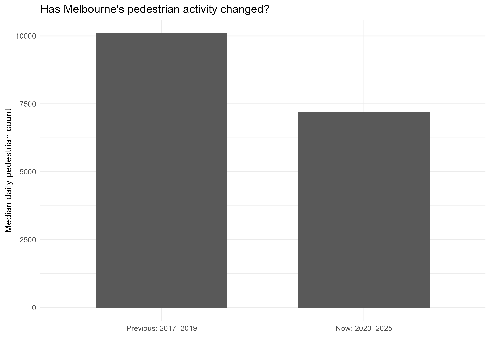
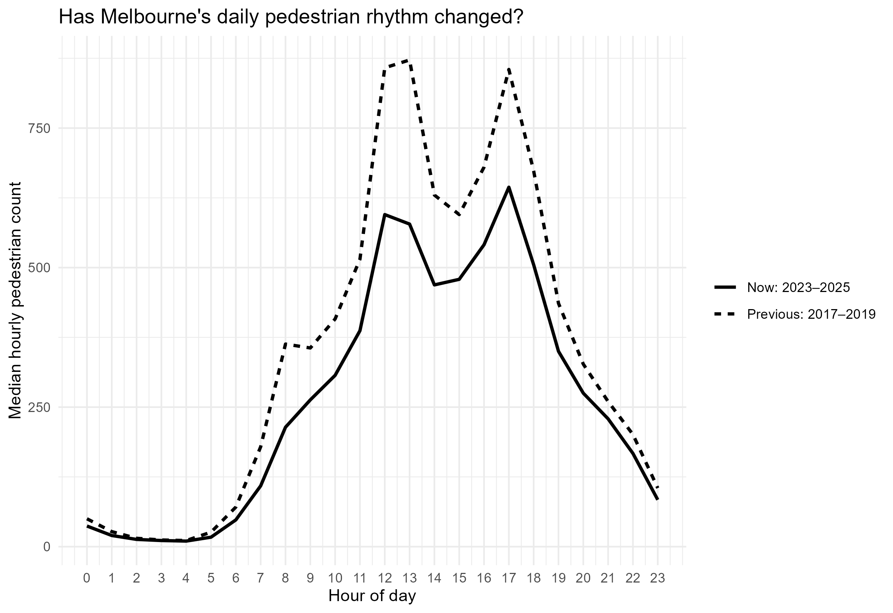
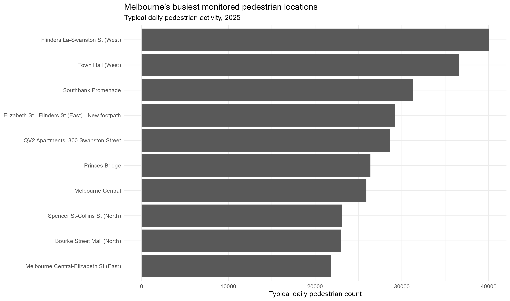

## {#cover}

:::: {.columns}

::: {.column width="47%"}

{.cover-logo}

::: {.cover-title}

**Pulse of Melbourne**

:::

::: {.cover-subtitle}

How does Melbourne move, and what changes its rhythm?

:::

::: {.cover-details}

ETC5543 · EBS-Business Analytics Project

Richa Anghan · Zhuo Zhang · Nishta Bollavaram

:::

:::

::: {.column width="53%"}

{.cover-image fig-alt="Pedestrians and trams in central Melbourne"}

::: {.cover-credit}

Photo: Luis Enrique Ascui / NCA NewsWire, via news.com.au

:::

:::

::::

::: {.notes}

Imagine standing on a busy Melbourne street.

Trams are arriving, people are heading to work,
and pedestrians are moving in different directions.

But what happens to the same street
on a Sunday or during a lockdown?

It's the same city, but its movement changes.

That is the idea behind Pulse of Melbourne.

:::

## Flinders Street came alive after dark {#flinders-opening-slide}

```{r}
#| echo: false
#| warning: false
#| message: false
#| fig-width: 10
#| fig-height: 5.5

library(data.table)
library(ggplot2)

ped <- fread(
  "../Data_pedestrians/raw/Pedestrian_Counting_System_Monthly_counts_per_hour_may_2009_to_14_dec_2022.csv",
  select = c("Year", "Month", "Mdate", "Day", "Time",
             "Sensor_ID", "Sensor_Name", "Hourly_Counts")
)

sensor_name <- "Flinders St-Elizabeth St (East)"

flinders_sat <- ped[
  Sensor_Name == sensor_name &
    Year == 2014 &
    Month == "February" &
    Day == "Saturday"
]

special_day <- flinders_sat[
  Mdate == 22,
  .(Time, Count = Hourly_Counts)
]
special_day[, Series := "22 Feb 2014"]

# Calculate the typical hourly pattern from the other Saturdays
typical_sat <- flinders_sat[
  Mdate != 22,
  .(Count = median(Hourly_Counts, na.rm = TRUE)),
  by = Time
]

typical_sat[, Series := "Other February Saturdays (median)"]

plot_data <- rbindlist(list(special_day, typical_sat))

p <- ggplot(plot_data, aes(
  x = Time, y = Count,
  colour = Series, linewidth = Series
)) +
  geom_line() +
  scale_x_continuous(breaks = seq(0, 23, by = 2)) +
  scale_colour_manual(values = c(
    "22 Feb 2014" = "#005EB8",
    "Other February Saturdays (median)" = "#8A8A8A"
  )) +
  scale_linewidth_manual(values = c(
    "22 Feb 2014" = 1.4,
    "Other February Saturdays (median)" = 1
  )) +
  labs(
    subtitle = "Flinders St–Elizabeth St (East)",
    x = "Hour of day",
    y = "Pedestrians per hour",
    colour = NULL,
    linewidth = NULL
  ) +
  theme_minimal(base_size = 20) +
  theme(
    plot.title = element_blank(),
    plot.subtitle = element_text(size = 16),
    legend.position = "top",
    panel.grid.minor = element_blank()
  )


library(plotly)

ggplotly(
  p,
  width = 1100,
  height = 520,
  tooltip = c("x", "y", "colour")
) |>
  layout(
    hovermode = "x unified",

    legend = list(
      orientation = "h",
      x = 0,
      y = 1.12,
      xanchor = "left",
      yanchor = "bottom",
      font = list(size = 17)
    ),

    margin = list(
      l = 90,
      r = 30,
      t = 85,
      b = 65
    ),

    font = list(size = 18)
  ) |>
  config(
    displaylogo = FALSE,
    responsive = TRUE
  )


```

::: {.notes}

Let’s go back to Flinders Street on Saturday, 22 February 2014.

This graph shows pedestrian activity across the day at the Flinders Street–Elizabeth Street East sensor.

The blue line is that specific Saturday, and the grey line shows a typical Saturday in February 2014.

What stands out is that activity was noticeably higher through much of the day, especially from late morning into the evening.

So right at the beginning of our analysis, we can already see that pedestrian movement in Melbourne is not static.
It changes depending on the day, the location and what is happening in the city.

That led us to our broader question:
how does Melbourne move, and what changes its rhythm?

:::

## Beyond Flinders Street {#sensor-map-slide}

::: {.map-subtitle}
Melbourne's pedestrian sensor network
:::

```{r}
#| label: sensor-location-map
#| echo: false
#| warning: false
#| message: false


library(data.table)
library(plotly)


# Official City of Melbourne sensor inventory
sensor_map <- fread(
  "figures/melbourne_sensor_locations.csv"
)

# Keep sensor IDs with valid coordinates
sensor_map <- unique(
  sensor_map[
    is.finite(latitude) &
    is.finite(longitude)
  ],
  by = "location_id"
)

setnames(
  sensor_map,
  c("latitude", "longitude"),
  c("lat", "lon")
)

# Hover information without 2025-only counts
sensor_map[, hover_text := paste0(
  "<b>", sensor_description, "</b>",
  "<br>Sensor ID: ", location_id,
  "<br>Installation date: ", installation_date
)]

# Interactive map
plot_ly(
  data = sensor_map,
  type = "scattermapbox",
  mode = "markers",
  lat = ~lat,
  lon = ~lon,
  text = ~hover_text,
  hoverinfo = "text",
  marker = list(
    size = 11,
    color = "#005EB8",
    opacity = 0.85
  ),
  showlegend = FALSE
) |>
  layout(
    mapbox = list(
      style = "open-street-map",
      center = list(
        lat = median(sensor_map$lat),
        lon = median(sensor_map$lon)
      ),
      zoom = 12.5
    ),
    width = 1050,
    height = 390,
    margin = list(l = 0, r = 0, t = 0, b = 0)
  ) |>
  config(
    displaylogo = FALSE,
    responsive = TRUE,
    scrollZoom = TRUE
  )


```

::: {.sensor-overview}

**What we'll explore**

- **Time:** Daily, weekly and seasonal rhythms
- **Change:** Long-term trends and COVID-19
- **Space:** Activity across different locations
- **Disruptions:** Events, rainfall and public holidays

:::

::: {.notes}

We've just seen how pedestrian activity
changed on one particular Saturday near
Flinders Street.

But Melbourne is much more than one street.

This map shows pedestrian sensor locations
across the city.

Using these observations, we investigated
four main areas.

First, Melbourne's daily, weekly and
seasonal rhythms.

Second, how activity has changed over
the years, particularly around COVID-19.

Third, how pedestrian patterns differ
between locations.

And finally, unusual changes linked to
events, rainfall and public holidays.

Let's begin by looking at how Melbourne's
pedestrian movement changes throughout
a normal day.

:::


## How Melbourne's sensor network evolved {#sensor-expansion-slide}

:::: {.columns}

::: {.column width="40%"}

### Our data

- **7.52 million** hourly observations
- **May 2009 – October 2026**
- **Source:** City of Melbourne pedestrian-counting system
- **Preparation:** Historical and recent records combined and validated

:::

::: {.column width="60%"}

{.installation-chart fig-alt="Bar chart showing new pedestrian sensor installations by year"}

:::

::::

::: {.notes}

To investigate Melbourne's pedestrian activity,
we used data from the City of Melbourne,
covering approximately 7.52 million hourly
observations between May 2009 and October 2026.

We combined historical records with recent
data and validated the observations.

One important point is that Melbourne's
pedestrian monitoring network expanded
over time, as shown in this graph.

This means we need to be careful when
comparing different years.

For our historical comparisons, we use
consistent sensor locations wherever possible.


:::


## Melbourne has its own daily rhythm {#daily-patterns-slide}


```{r}

#| label: daily-pedestrian-patterns
#| echo: false
#| warning: false
#| message: false

library(plotly)

# Original interactive graph — no colour changes
daily_graph <- readRDS("figures/daily_plotly.rds")

daily_graph |>
  layout(
    width = 1150,
    height = 480
  ) |>
  config(
    displaylogo = FALSE,
    responsive = TRUE
  )

```

::: {.notes}

After seeing where Melbourne's pedestrian sensors are located,
let's look at how activity changes throughout a typical day.

Pedestrian movement is not evenly distributed across 24 hours.

Activity is generally quieter overnight, increases during
the morning, and becomes much busier around lunchtime
and the late afternoon.

This shows that Melbourne has a recognisable daily rhythm.

:::

## How has Melbourne's weekly rhythm changed? {#weekly-patterns-slide}

```{r}

#| label: weekly-pedestrian-patterns
#| echo: false
#| warning: false
#| message: false

library(plotly)
library(readr)
library(dplyr)

# Load weekly data covering 2009–2026
weekly_periods <- read_csv(
  "figures/weekly_periods.csv",
  show_col_types = FALSE
)

# All seven days
days <- c(
  "Monday", "Tuesday", "Wednesday",
  "Thursday", "Friday",
  "Saturday", "Sunday"
)

# Four periods covering the full study
periods <- c(
  "2009–2014",
  "2015–2019",
  "2020–2022",
  "2023–2026"
)

weekly_periods <- weekly_periods |>
  mutate(
    day = factor(day, levels = days),
    period = factor(period, levels = periods)
  ) |>
  arrange(period, day)

# Interactive line graph
weekly_graph <- plot_ly(
  data = weekly_periods,
  x = ~day,
  y = ~activity_index,
  color = ~period,
  colors = c(
    "2009–2014" = "#005EB8",
    "2015–2019" = "#9467BD",
    "2020–2022" = "#D97706",
    "2023–2026" = "#159A88"
  ),
  type = "scatter",
  mode = "lines+markers",
  line = list(width = 3),
  marker = list(size = 8),
  hovertemplate = paste0(
    "<b>%{fullData.name}</b>",
    "<br>Day: %{x}",
    "<br>Activity index: %{y:.1f}",
    "<extra></extra>"
  )
) |>
  layout(
    width = 1150,
    height = 480,

    xaxis = list(
      title = "Day of week",
      type = "category",
      categoryorder = "array",
      categoryarray = days,
      automargin = TRUE
    ),

    yaxis = list(
      title = "Activity index (100 = yearly average)",
      showgrid = TRUE,
      automargin = TRUE
    ),

    legend = list(
      orientation = "h",
      x = 0.5,
      xanchor = "center",
      y = 1.15
    ),

    font = list(size = 15),

    margin = list(
      l = 85,
      r = 65,
      t = 65,
      b = 75
    )
  ) |>
  config(
    displaylogo = FALSE,
    responsive = TRUE
  )

# Display the graph in Quarto
weekly_graph


```

::: {.notes}

We investigated how Melbourne's weekly pedestrian
rhythm has changed across the available years.

To make the changes easier to see, we summarised
2009 to 2026 into four periods.

Each line shows the relative activity pattern
from Monday to Sunday.

This allows us to examine whether the busiest
days have shifted over time, including whether
weekday and weekend activity patterns differ.

The index measures relative activity rather than
total pedestrian counts.

Because the monitoring network changes over time,
these results describe the observed network
rather than a fixed set of locations.

:::


## Melbourne's pedestrian activity changes with the seasons {#seasonal-patterns}

:::: {.columns}

::: {.column width="50%"}

{fig-alt="Monthly pedestrian activity showing variation throughout the year"}

:::

::: {.column width="50%"}

{fig-alt="Seasonal pedestrian activity showing lower activity during winter"}

:::

::::

::: {.notes}

We've seen how pedestrian movement changes
throughout the day and week.

But does Melbourne also have a seasonal rhythm?

On the left, the monthly graph shows that
pedestrian activity varies throughout the year,
with a noticeable decline around June.

The graph on the right shows a similar pattern
when we group activity by season.

Winter generally has lower pedestrian activity
than the warmer parts of the year.

This suggests that Melbourne's pedestrian
rhythm is influenced by the time of year.

However, these graphs alone don't establish
whether temperature or rainfall causes the
difference. We'll examine rainfall separately
later in the presentation.

:::


## Melbourne's pedestrian activity over time {#long-term-slide}

```{r}
#| label: long-term-pedestrian-trend
#| echo: false
#| warning: false
#| message: false

library(plotly)

long_term_graph <- readRDS(
  "figures/long_term_plotly.rds"
)

long_term_graph |>
  plotly::layout(
    title = list(text = ""),
    font = list(size = 15),
    margin = list(
      l = 90,
      r = 40,
      t = 35,
      b = 75
    )
  ) |>
  plotly::config(
    displaylogo = FALSE,
    responsive = TRUE
  )
```

::: {.covid-takeaway}
**Key finding:** COVID-19 marked a major break in Melbourne's pedestrian activity, with sharp declines during 2020–2021.
:::


::: {.notes}

We also examined Melbourne's long-term
pedestrian activity using common sensor
locations.

The graph shows monthly median activity
over the available years.

This helps us identify long-term changes,
including major disruptions and subsequent
recovery.

:::

## Has Melbourne returned to its earlier pedestrian activity? {#then-now}

:::: {.columns}

::: {.column width="50%"}

{fig-alt="Comparison of typical daily pedestrian activity before and after COVID-19"}

:::

::: {.column width="50%"}

{fig-alt="Comparison of hourly pedestrian activity profiles before and after COVID-19"}

:::
::::

## Where is Melbourne busiest on foot? {#spatial-pulse}

{fig-alt="Top ten monitored pedestrian locations ranked by median daily pedestrian count in 2025"}


## Two distinct pedestrian rhythms {#cluster-slide}

:::: {.columns}

::: {.column width="50%"}

{fig-alt="Weekday and weekend pedestrian activity patterns for the two clusters"}

:::

::: {.column width="50%"}

```{r}
#| echo: false
#| warning: false
#| message: false
#| out-width: 100%

library(plotly)

cluster_map <- readRDS("figures/cluster_map.rds")

cluster_map
```

:::

::::

:::: {.columns}

::: {.column width="50%"}

::: {.cluster-one}
**CLUSTER 1 · 9 SENSORS**

Stronger weekday-focused activity peaks.
:::

:::

::: {.column width="50%"}

::: {.cluster-two}
**CLUSTER 2 · 35 SENSORS**

Broader daytime and weekend activity.
:::

:::

::::

::: {.notes}
We have explored when Melbourne's pedestrian activity changes and where it is concentrated.

Our final analysis looks at whether different locations follow similar daily activity patterns.

Using data from 2023 to 2025, we selected sensor locations with sufficient coverage across all three years.

We applied K-means clustering to their normalised hourly activity profiles, separately considering weekdays and weekends.

This identified two groups across 44 monitored locations.

Cluster 1 contains nine locations, with stronger weekday-focused activity peaks, often associated with commuter areas.

Cluster 2 contains 35 locations and shows broader daytime and weekend activity.

The graph compares these patterns, while the interactive map shows where the two groups are located.

The key finding is that Melbourne does not have one uniform pedestrian rhythm. Different locations experience different patterns of demand.

This can help inform more location-specific planning and management of public spaces.
:::

## Major pedestrian surges coincide with city events {#event-surge-slide}

::: {.event-surge-graph}

```{r}

#| echo: false
#| warning: false
#| message: false
#| out-width: "100%"

library(plotly)

event_plot_interactive <- readRDS(
  "figures/event_plot_interactive.rds"
)

event_plot_interactive <- event_plot_interactive |>
  plotly::layout(
    title = list(text = ""),
    autosize = TRUE,
    width = NULL,
    height = 390,
    margin = list(
      l = 75,
      r = 25,
      t = 25,
      b = 55
    ),
    font = list(size = 13)
  ) |>
  plotly::config(
    displayModeBar = FALSE,
    displaylogo = FALSE,
    scrollZoom = FALSE
  )

event_plot_interactive

```

:::

::: {.event-surge-finding}
**22 February 2014:** The largest matched surge, with pedestrian activity **51.7% above expected levels**.
:::


## When does Melbourne slow down? {#weather-slide}

::: {.weather-chart}

```{r}
#| echo: false
#| warning: false
#| message: false
#| out-width: "100%"

library(plotly)

rainfall_plot <- readRDS(
  "figures/rainfall_interactive.rds"
)

# Adjust presentation display only
rainfall_plot <- rainfall_plot |>
  plotly::layout(
    title = list(text = ""),
    autosize = TRUE,
    width = NULL,
    height = 410,
    margin = list(
      l = 85,
      r = 25,
      t = 15,
      b = 85
    ),
    font = list(size = 14)
  ) |>
  plotly::config(
    displayModeBar = FALSE,
    displaylogo = FALSE,
    scrollZoom = FALSE
  )

rainfall_plot
```

:::

:::: {.weather-findings}

::: {.weather-finding}
**HEAVY RAINFALL**

**24.7%** of days with ≥10 mm rainfall had significant pedestrian decreases, compared with **1.3%** of days with less rain.
:::

::: {.weather-finding}
**PUBLIC HOLIDAYS**

**34.9%** of public holidays had significant pedestrian decreases, compared with **2.5%** of other days.
:::

::::


## Melbourne has a rhythm - but it never stands still. {#conclusion-slide}

::: {.conclusion-content}

::: {.conclusion-item}
<span class="conclusion-number">01</span>

::: {.conclusion-text}
**One city, different rhythms**

Melbourne follows familiar daily and weekly patterns, but its streets don't all move to the same beat.
:::
:::

::: {.conclusion-item}
<span class="conclusion-number">02</span>

::: {.conclusion-text}
**The city hasn't returned to its old pace**

Across 27 consistently monitored locations, typical daily pedestrian activity was **28.5% lower in 2023–2025 than in 2017–2019**.
:::
:::

::: {.conclusion-item}
<span class="conclusion-number">03</span>

::: {.conclusion-text}
**Some days change everything**

Major events coincide with unexpected surges, while heavy rain and public holidays are linked to quieter streets.
:::
:::

:::

::: {.conclusion-ending}
**Melbourne's rhythm isn't just about when people move. It's about where they go, how the city has changed, and what brings it to life.**
:::

