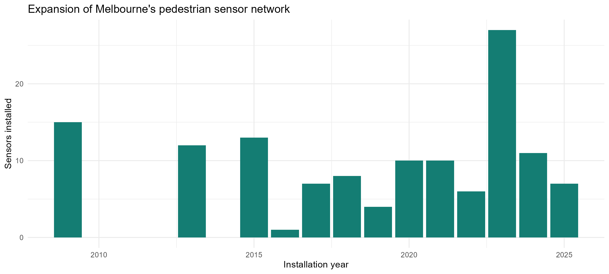
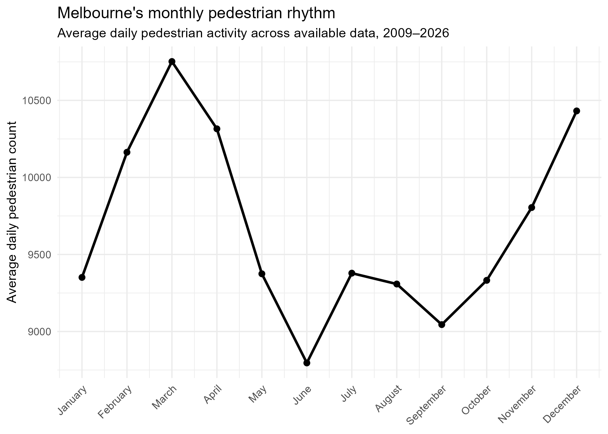
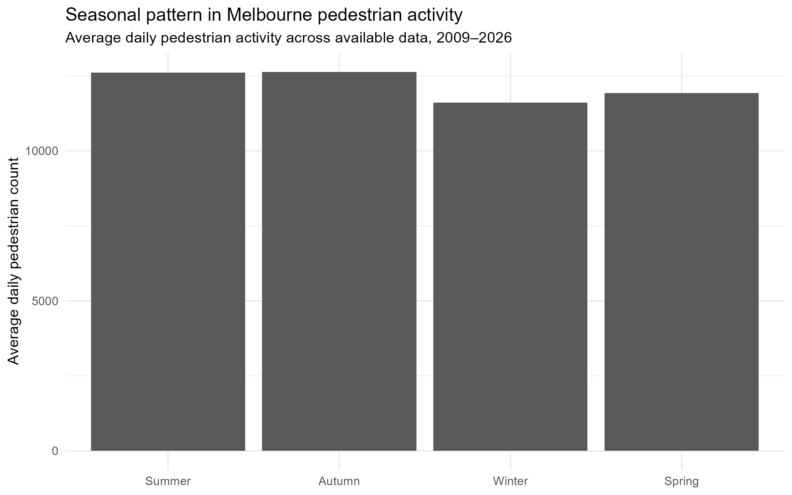
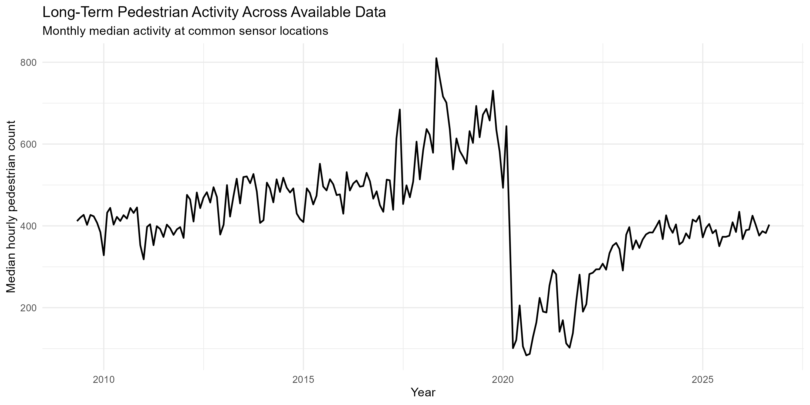
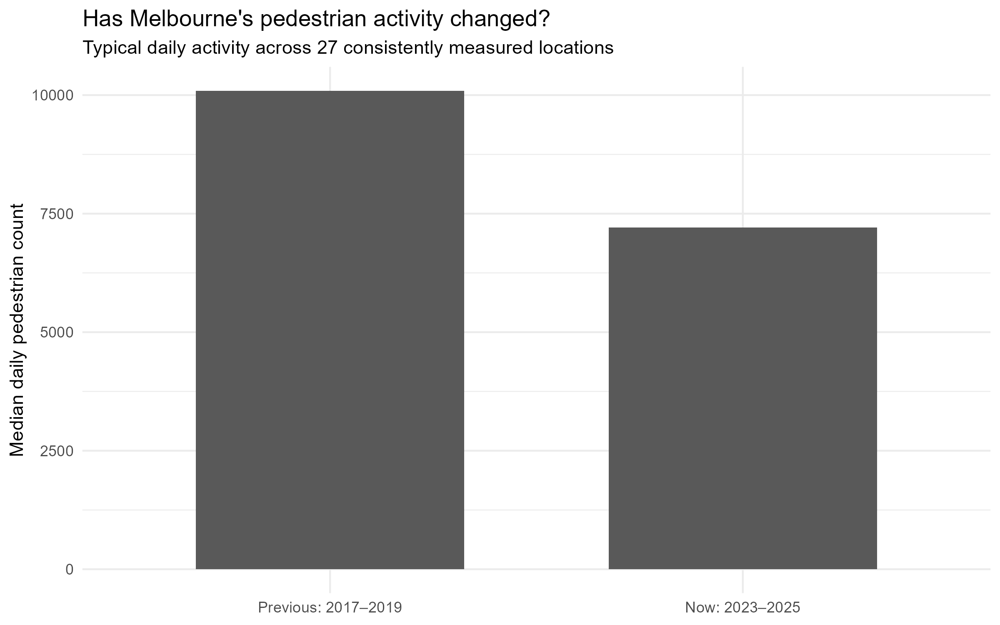
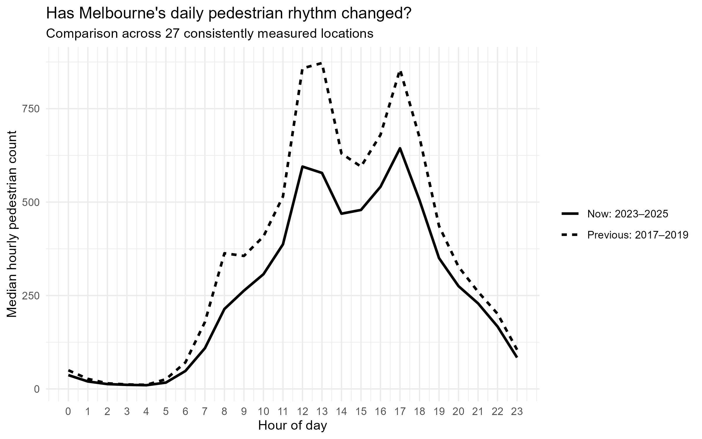
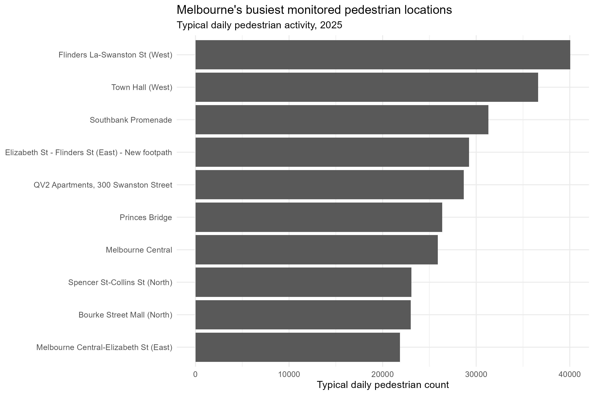
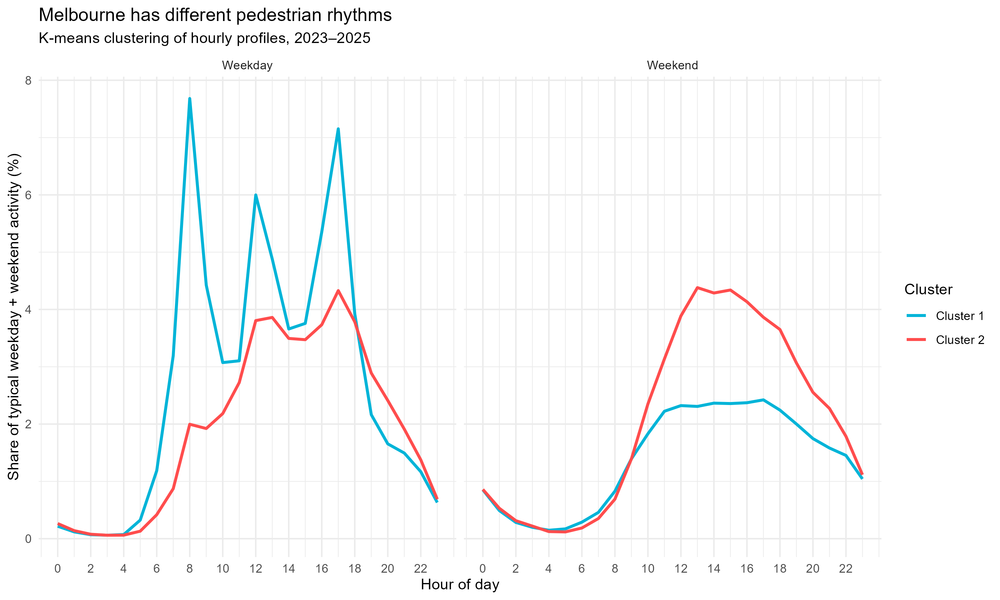

---
format:
  revealjs:
    theme: simple
    css: style.css
    slide-number: true
    transition: fade
    center: true
execute:
  echo: false
  warning: false
  message: false
---

##  {#cover background-color="#FAF9F5"}

::: cover-top
ETC5543 · BUSINESS ANALYTICS PROJECT

MONASH UNIVERSITY · 2026
:::

:::::::::: cover-main
:::::::: cover-left
::: cover-title
**PULSE OF**

**MELBOURNE**
:::

::: teal-line
:::

::: cover-question
**How does Melbourne move and how has that changed?**
:::

::: cover-description
Exploring pedestrian rhythms, long-term changes and disruptions across the city.
:::

::: cover-team
**PRESENTED BY**

Richa Anghan 35760982 · Zhuo Zhang 35585994 · Nishta Bollavaram 35769378
:::
::::::::

::: cover-right
{width="100%" fig-alt="Decorative flowing wave illustration"}
:::
::::::::::

::: cover-bottom
CITY OF MELBOURNE · PEDESTRIAN COUNTING SYSTEM

RHYTHM / CHANGE / DISRUPTION
:::

##  {#motivation background-color="#FAF9F5"}

::: motivation-top
**01 / THE MOTIVATION**

PULSE OF MELBOURNE
:::

::: motivation-title
**A changing city needs more than just foot traffic numbers.**
:::

::: motivation-line
:::

::: motivation-intro
Pedestrian activity reveals when people use Melbourne, how patterns vary across locations, and how these patterns evolve over time.
:::

:::::: motivation-cards
::: motivation-card
**01 / WHEN**

Daily, weekly and seasonal pedestrian rhythms.
:::

::: motivation-card
**02 / WHERE**

Locations experiencing important changes in activity.
:::

::: motivation-card
**03 / HOW IT CHANGES**

Long-term shifts, disruptions and unusual periods.
:::
::::::

::: motivation-takeaway
**OUR GOAL**

Turn pedestrian counts into useful evidence for understanding Melbourne's changing activity.
:::

::: motivation-bottom
:::

::: notes
Pedestrian counts tell us more than how busy Melbourne is.

We want to understand when people use the city, how activity differs across locations, and how these patterns have changed over time.

These insights may help the City of Melbourne understand changing pedestrian demand and inform planning decisions.
:::

##  {#data-preparation background-color="#FAF9F5"}

::: data-top
**02 / DATA & PREPARATION**

PULSE OF MELBOURNE
:::

::: data-title
**From raw records to reliable pedestrian data**
:::

::: data-line
:::

:::::: data-sources
::: data-source
**01 / HISTORICAL**

### Historical CSV

2009–2022

source: City of Melbourne
:::

::: data-source
**02 / CURRENT**

### Open Data API

2024-2026

source: City of Melbourne
:::

::: data-source
**03 / PROVIDED**

### Data snapshots

2022–2025

Provided by City of Melbourne Data Operations Manager
:::
::::::

::: data-process
**STANDARDISE → REPAIR → VALIDATE → INTEGRATE**

Standardised data formats · Reconstructed duplicated hour labels · Cross-checked overlapping records
:::

::: data-result
**pedestrian_full**

**7,523,688 hourly observations**

May 2009 – October 2026
:::

::: data-support
**SUPPORTING DATASETS**

Event permits · Public holidays · Daily weather · Sensor location metadata
:::

::: notes
We combined pedestrian counts from three sources: historical CSV records, the recent Open Data API, and annual data snapshots received from the City of Melbourne Data Operations Manager in September 2026.

The snapshots cover 2022 to 2025 and helped us recover missing data, particularly for 2023.

We also repaired duplicated historical hour labels rather than simply deleting the affected records. We cross-checked overlapping sources and used the validated snapshots for 2022 to 2025.

Our final dataset contains approximately 7.52 million hourly pedestrian records, with no remaining duplicate sensor-date-hour keys or missing pedestrian counts.

Finally, we incorporated supporting datasets on events, public holidays, weather and sensor locations for the later analyses.
:::

##  {#sensor-coverage background-color="#FAF9F5"}

::: sc-top
**03 / DATA COMPARABILITY**

PULSE OF MELBOURNE
:::

::: sc-title
**Melbourne's expanding sensor network complicates historical comparisons.**
:::

::: sc-line
:::

::: sc-intro
New sensor installations expanded the monitoring network over time, making comparisons of raw city-wide pedestrian totals potentially misleading.
:::

::: sc-graph
{fig-alt="Bar chart of pedestrian sensors installed by year based on available installation dates"}
:::

::::: sc-cards
::: sc-card
**THE CHALLENGE**

Additional monitored locations can contribute to higher recorded pedestrian totals.
:::

::: sc-card
**OUR APPROACH**

Sensor-level averages, normalised indices, coverage checks and matched sensors where appropriate.
:::
:::::

::: sc-takeaway
**Different parts required different comparison methods.**
:::

::: notes
Before examining long-term changes, we looked at how Melbourne's sensor network had expanded.

This graph shows the number of sensors installed each year, based on recorded installation dates.

The important issue is that more sensors can lead to higher recorded city-wide totals, even without a corresponding increase in activity at existing locations.

To address this, our analysis uses different methods depending on the research question.

For daily patterns, we calculate sensor-level averages and normalised indices.

For our historical comparison, we selected 27 consistently monitored locations.

And for unusual days, we used sensor-specific baselines and coverage checks.

These approaches make comparisons more meaningful, although changes in coverage still need to be considered when interpreting our results.
:::

##  {#daily-rhythm background-color="#FAF9F5"}

::: daily-top
**04 / TEMPORAL PATTERNS**

PULSE OF MELBOURNE
:::

::: daily-title
**Melbourne's daily pulse follows a recognisable pattern.**
:::

::: daily-line
:::

::: daily-graph
```{r}
#| echo: false
#| warning: false
#| message: false
#| out-width: "100%"
#| fig-height: 5

library(plotly)

readRDS("figures/daily_plotly.rds")
```
:::

::: daily-takeaway
**KEY FINDING**

Pedestrian activity varies throughout the day, with distinct periods of higher and lower activity.
:::

::: notes
We began by examining how Melbourne's pedestrian activity changes throughout the day.

This interactive graph shows the hourly pattern for each year from 2009 to 2026.

We first calculated average counts at the sensor level, then normalised activity within each year.

An index of 100 represents that year's average hourly activity level.

This allows us to compare the shape of daily activity across years rather than simply comparing total pedestrian counts.

We can also interact with individual years to explore similarities and differences in their daily patterns.
:::

##  {#weekly-rhythm-slide background-color="#FAF9F5"}

::: weekly-top
**05 / TEMPORAL PATTERNS**

PULSE OF MELBOURNE
:::

::: weekly-title
**Melbourne's pedestrian activity changes across the week.**
:::

::: weekly-line
:::

::: weekly-graph
```{r}
#| echo: false
#| warning: false
#| message: false
#| out-width: "100%"
#| fig-height: 5

library(plotly)

readRDS("figures/weekly_plotly.rds")
```
:::

::: weekly-takeaway
**KEY FINDING**

Activity generally increases towards Friday and declines over the weekend, although the pattern varies between years.
:::

::: notes
We also investigated how pedestrian activity changes across the week.

The graph uses the same yearly normalisation approach as the daily analysis.

Across many of the years, activity tends to build through the working week, often reaching its highest level on Friday before declining over the weekend.

The differences between yearly lines also show that the weekly pattern is not identical in every year.

This gives us another perspective on Melbourne's regular pedestrian rhythm.
:::

##  {#monthly-seasonal background-color="#FAF9F5"}

::: ms-top
**06 / TEMPORAL PATTERNS**

PULSE OF MELBOURNE
:::

::: ms-title
**Melbourne's pedestrian pulse also changes throughout the year.**
:::

::: ms-line
:::

::: ms-intro
Average daily pedestrian activity varies across months and seasons.
:::

::::: ms-graphs
::: ms-graph
{fig-alt="Original monthly pedestrian rhythm line chart from the project analysis"}
:::

::: ms-graph
{fig-alt="Original seasonal pedestrian activity bar chart from the project analysis"}
:::
:::::

::: ms-takeaway
**KEY FINDING**

Monthly and seasonal differences provide important context for interpreting Melbourne's pedestrian activity.
:::

::: notes
After examining daily and weekly patterns, we also investigated how pedestrian activity varies across months and seasons.

The monthly graph compares average daily pedestrian activity across the calendar year.

The seasonal graph provides a broader view, grouping activity into summer, autumn, winter and spring.

For these analyses, we aggregated pedestrian counts at the sensor level rather than simply adding together all city-wide observations.

These graphs help us understand broader recurring patterns in Melbourne's activity.

We can then distinguish these regular variations from the more substantial long-term changes and unusual disruptions investigated later.
:::

##  {#long-term background-color="#FAF9F5"}

::: lt-top
**07 / LONG-TERM CHANGE**

PULSE OF MELBOURNE
:::

::: lt-title
**A major disruption reshaped Melbourne's pedestrian activity.**
:::

::: lt-line
:::

::: lt-graph
{fig-alt="Original long-term monthly pedestrian activity graph at common sensor locations"}
:::

:::::: lt-insights
::: lt-card
**BEFORE 2020**

Generally increasing pedestrian activity.
:::

::: lt-card
**2020–2021**

Sharp decline during the pandemic period.
:::

::: lt-card
**RECENT YEARS**

Recovery, but below several earlier peaks.
:::
::::::

::: notes
We also examined how Melbourne's pedestrian activity changed over the longer term.

For this analysis, we identified sensor locations appearing across our selected full calendar years.

We then calculated monthly average hourly activity for each sensor and took the median across the reporting sensors.

The graph shows a generally increasing pattern before 2020, followed by a dramatic decline during the pandemic.

We then observe a gradual recovery, although recent activity remains below several earlier peaks.

This highlights how a major disruption can reshape Melbourne's pedestrian activity.
:::

##  {#then-now background-color="#FAF9F5"}

::: tn-top
**08 / HISTORICAL COMPARISON**

PULSE OF MELBOURNE
:::

::: tn-title
**Pedestrian activity is lower, but the daily rhythm remains recognisable.**
:::

::: tn-line
:::

::::: tn-graphs
::: tn-graph
{fig-alt="Original comparison of median daily pedestrian counts in 2017–2019 and 2023–2025"}
:::

::: tn-graph
{fig-alt="Original hourly pedestrian comparison between 2017–2019 and 2023–2025 using 27 consistently monitored locations"}
:::
:::::

:::::: tn-result
::: tn-stat
**−28.5%**

Change in median daily pedestrian count
:::

::: tn-stat
**10,091 → 7,211**

Median daily count\
2017–2019 vs 2023–2025
:::

::: tn-stat
**27 consistent locations**

At least 300 observed days\
in each comparison year
:::
::::::

::: notes
After looking at the long-term changes, we wanted to see whether Melbourne had returned to its earlier pedestrian activity.

To make a fairer comparison, we selected 27 sensor locations with at least 300 observed days in each comparison year.

The first graph compares typical daily pedestrian counts between 2017 to 2019 and 2023 to 2025.

We found that the median decreased from 10,091 to 7,211, a reduction of 28.5%.

The second graph looks at how activity changed throughout the day.

Although the recent hourly counts are generally lower, we still observe recognisable midday and late-afternoon peaks.

This suggests that the level of activity has changed more noticeably than its overall daily pattern.

These results describe the selected locations, not the entire city.
:::

##  {#spatial-pulse background-color="#FAF9F5"}

::: sp-top
**9 / SPATIAL ACTIVITY**

PULSE OF MELBOURNE
:::

::: sp-title
**Melbourne's pedestrian pulse is concentrated in key locations.**
:::

::: sp-line
:::

::: sp-bars
{fig-alt="Top Ten busiest monitored pedestrian locations in Melbourne in 2025"}
:::

::: sp-method
**2025 DATA** · Median daily pedestrian count · At least 20 observed hours per day and 292 valid days per included location
:::

::: sp-takeaway
**KEY FINDING**

Pedestrian activity varies considerably across monitored locations, with high counts around Flinders Lane, Town Hall and Southbank Promenade.
:::

::: notes
So far, we've mainly looked at how Melbourne's pedestrian activity changes over time.

But we also wanted to understand where people are walking.

For this analysis, we focused on 2025.

We selected well-covered sensor locations, requiring at least 20 observed hours per valid day and 292 valid days per location.

We then calculated the median daily pedestrian count for each location.

The interactive plot shows where the sensors are located, with larger points representing higher pedestrian activity.

The second graph identifies the busiest monitored locations.

We can see that activity is not distributed evenly. Some locations, particularly around central destinations, record substantially higher counts.

This is useful for understanding where pedestrian demand is concentrated, while recognising that our results only describe locations covered by the sensor network.
:::

##  {#pedestrian-clusters background-color="#FAF9F5"}

::: cl-top
**11 / PEDESTRIAN BEHAVIOUR**

PULSE OF MELBOURNE
:::

::: cl-title
**Melbourne's locations follow two distinct pedestrian rhythms.**
:::

::: cl-line
:::

::::: cl-visuals
::: cl-profile
{fig-alt="Original K-means weekday and weekend pedestrian activity profiles for two groups of Melbourne sensors"}
:::

::: cl-map
```{r}
#| echo: false
#| warning: false
#| message: false
#| fig-height: 4
#| out-width: "100%"

library(plotly)

readRDS("figures/cluster_map.rds")
```
:::
:::::

::::: cl-insights
::: cl-card
**CLUSTER 1 · 9 SENSORS**

Sharper weekday activity peaks.
:::

::: cl-card
**CLUSTER 2 · 35 SENSORS**

Broader daytime and relatively stronger weekend activity.
:::
:::::

::: cl-method
**METHOD:** 44 eligible sensors (2023–2025) · K-means clustering · 2 clusters selected using silhouette score (0.442)
:::

::: notes
After identifying Melbourne's busiest locations, we wanted to understand whether different areas also have different pedestrian rhythms.

We used K-means clustering on 44 sensors with sufficient coverage from 2023 to 2025.

Rather than using total pedestrian counts, we compared the relative hourly activity patterns across weekdays and weekends.

We tested two to five clusters, and the two-cluster solution had the highest silhouette score of 0.442.

The first graph shows the differences between the two activity profiles.

Cluster 1 contains nine sensors with sharper weekday activity peaks.

Cluster 2 contains 35 sensors with broader daytime patterns and relatively stronger weekend activity.

The interactive map shows where these two types of pedestrian rhythms occur across Melbourne.

This demonstrates that different monitored locations can have distinct patterns of pedestrian activity.
:::

##  {#event-surges background-color="#FAF9F5"}

::: ev-top
**12 / UNUSUAL ACTIVITY**

PULSE OF MELBOURNE
:::

::: ev-title
**Major pedestrian surges coincided with permitted city events.**
:::

::: ev-line
:::

::: ev-graph
```{r}
#| echo: false
#| warning: false
#| message: false
#| fig-height: 4.5
#| out-width: "100%"

library(plotly)

readRDS("figures/event_surges.rds")
```
:::

::::: ev-insights
::: ev-card
**22 FEBRUARY 2014**

**+51.7% median uplift**

24 of 30 reporting sensors recorded at least 20% above expected activity.
:::

::: ev-card
**11 EVENT-MATCHED DATES**

Significant pedestrian surges overlapped with permitted events during 2014–2018.
:::
:::::

::: notes
After identifying Melbourne's normal rhythms, we wanted to understand unusual increases in pedestrian activity.

Rather than simply selecting the busiest dates, we compared each sensor's daily count with its expected activity based on nearby observations for the same weekday.

We then identified dates where activity increased substantially across multiple sensors.

We matched these unusual periods with City of Melbourne event-permit records.

For example, on 22 February 2014, the median pedestrian uplift was 51.7 percent, and 24 of the 30 reporting sensors recorded activity at least 20 percent above expected.

That date coincided with several permitted city events.

Our analysis identified eleven dates with plausible event-permit matches.

Although this suggests that major events may be associated with pedestrian surges, overlapping dates alone cannot establish causation.
:::

##  {#weather-holidays background-color="#FAF9F5"}

::: wx-top
**13 / WEATHER & HOLIDAYS**

PULSE OF MELBOURNE
:::

::: wx-title
**Heavy rainfall and public holidays coincide with quieter pedestrian days.**
:::

::: wx-line
:::

::: wx-graph
```{r}
#| echo: false
#| warning: false
#| message: false
#| out-width: "100%"

library(plotly)

readRDS("figures/rainfall_interactive.rds")
```
:::

::::: wx-insights
::: wx-card
**HEAVY RAINFALL**

**24.7% vs 1.3%**

Significant-dip rate on heavy-rain vs lighter-rain days.
:::

::: wx-card
**PUBLIC HOLIDAYS**

**22 of 63 days**

Public holidays with significant pedestrian declines.
:::
:::::

::: wx-method
**ANALYSIS:** 2019 and 2023–2026 · Significant dip: ≥20% median decline across sensors, with ≥30% of sensors declining by ≥20%.
:::

::: notes
We've explored the days when Melbourne becomes unusually busy.

But what about days when pedestrian activity falls significantly?

We investigated whether rainfall and public holidays were associated with these declines.

Using daily weather data, we grouped days by rainfall intensity and compared how frequently significant pedestrian decreases occurred.

The results show that around 25 percent of heavy-rainfall days recorded a significant decline, compared with just 1.3 percent of days with less than 10 millimetres of rainfall.

We also investigated public holidays.

Out of 63 eligible public holidays, 22 coincided with significant decreases in pedestrian activity.

These findings suggest that weather conditions and changes in normal working routines are associated with quieter pedestrian days.

However, these are observed associations, not proof of direct causation.
:::

##  {#final-insights background-color="#FAF9F5"}

::: fi-top
**14 / KEY TAKEAWAYS**

PULSE OF MELBOURNE
:::

::: fi-title
**Melbourne has a recognisable pulse, but not a single one.**
:::

::: fi-line
:::

::::::: fi-grid
::: fi-card
**Predictable patterns**

Daily peaks, weekly cycles and seasonal variation shape pedestrian activity.
:::

::: fi-card
**Long-term shifts**

Median daily counts were **28.5% lower** in 2023–2025 than in 2017–2019 at 27 consistently monitored locations.
:::

::: fi-card
**Location matters**

Pedestrian activity is concentrated at particular destinations, and locations show different weekday/weekend profiles.
:::

::: fi-card
**Unusual days have context**

Event permits, rainfall and public holidays coincide with notable changes in pedestrian activity.
:::
:::::::

::: fi-implication
**WHAT THIS MEANS FOR THE CITY**

Pedestrian planning should account for **when, where and under what conditions** people use Melbourne.
:::

::: fi-limitation
**LIMITATIONS:** Sensor coverage and comparability vary over time. Observed associations do not establish causation.
:::

::: notes
So, what does all of this tell us about Melbourne's pedestrian pulse?

First, the city has recognisable patterns. Pedestrian activity changes throughout the day, across the week and between seasons.

Second, these patterns have changed over time. In our matched-location comparison, typical daily counts were 28.5 percent lower in 2023 to 2025 than in 2017 to 2019.

Third, pedestrian activity is not evenly distributed across the city. Different monitored locations also have different weekday and weekend rhythms.

Finally, unusual changes are often associated with external conditions, including major events, rainfall and public holidays.

For city planners, this means that pedestrian demand should not be treated as the same everywhere or at every time.

Our findings can support more location-specific decisions about pedestrian infrastructure, event preparation and public-space management.

However, changes in sensor coverage and the observational nature of the analysis limit causal conclusions.

Overall, Melbourne has a recognisable pulse, but it varies across locations, over time and with changing conditions.
:::
