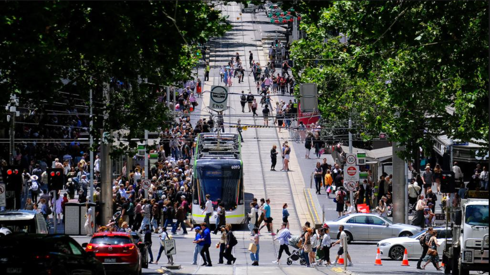

## {#cover}

:::: {.columns}

::: {.column width="47%"}

{.cover-logo}

::: {.cover-title}

**Pulse of Melbourne**

:::

::: {.cover-subtitle}

How does Melbourne move, and what changes its rhythm?

:::

::: {.cover-details}

ETC5543 · EBS-Business Analytics Project

Richa Anghan · Zhuo Zhang · Nishta Bollavaram

:::

:::

::: {.column width="53%"}

{.cover-image fig-alt="Pedestrians and trams in central Melbourne"}

::: {.cover-credit}

Photo: Luis Enrique Ascui / NCA NewsWire, via news.com.au

:::

:::

::::

::: {.notes}

Imagine standing on a busy Melbourne street.

Trams are arriving, people are heading to work,
and pedestrians are moving in different directions.

But what happens to the same street
on a Sunday or during a lockdown?

It's the same city, but its movement changes.

That is the idea behind Pulse of Melbourne.

:::

## Flinders Street came alive after dark

```{r}
#| echo: false
#| warning: false
#| message: false
#| fig-width: 10
#| fig-height: 5.5

library(data.table)
library(ggplot2)

ped <- fread(
  "../Data_pedestrians/raw/Pedestrian_Counting_System_Monthly_counts_per_hour_may_2009_to_14_dec_2022.csv",
  select = c("Year", "Month", "Mdate", "Day", "Time",
             "Sensor_ID", "Sensor_Name", "Hourly_Counts")
)

sensor_name <- "Flinders St-Elizabeth St (East)"

flinders_sat <- ped[
  Sensor_Name == sensor_name &
    Year == 2014 &
    Month == "February" &
    Day == "Saturday"
]

special_day <- flinders_sat[
  Mdate == 22,
  .(Time, Count = Hourly_Counts)
]
special_day[, Series := "22 Feb 2014"]

# Calculate the typical hourly pattern from the other Saturdays
typical_sat <- flinders_sat[
  Mdate != 22,
  .(Count = median(Hourly_Counts, na.rm = TRUE)),
  by = Time
]

typical_sat[, Series := "Other February Saturdays (median)"]

plot_data <- rbindlist(list(special_day, typical_sat))

p <- ggplot(plot_data, aes(
  x = Time, y = Count,
  colour = Series, linewidth = Series
)) +
  geom_line() +
  scale_x_continuous(breaks = seq(0, 23, by = 2)) +
  scale_colour_manual(values = c(
    "22 Feb 2014" = "#005EB8",
    "Other February Saturdays (median)" = "#8A8A8A"
  )) +
  scale_linewidth_manual(values = c(
    "22 Feb 2014" = 1.4,
    "Other February Saturdays (median)" = 1
  )) +
  labs(
    subtitle = "Flinders St–Elizabeth St (East)",
    x = "Hour of day",
    y = "Pedestrians per hour",
    colour = NULL,
    linewidth = NULL
  ) +
  theme_minimal(base_size = 20) +
  theme(
    plot.title = element_blank(),
    plot.subtitle = element_text(size = 16),
    legend.position = "top",
    panel.grid.minor = element_blank()
  )


library(plotly)

ggplotly(
  p,
  width = 1100,
  height = 520,
  tooltip = c("x", "y", "colour")
) |>
  layout(
    hovermode = "x unified",

    legend = list(
      orientation = "h",
      x = 0,
      y = 1.12,
      xanchor = "left",
      yanchor = "bottom",
      font = list(size = 17)
    ),

    margin = list(
      l = 90,
      r = 30,
      t = 85,
      b = 65
    ),

    font = list(size = 18)
  ) |>
  config(
    displaylogo = FALSE,
    responsive = TRUE
  )


```

::: {.notes}

Let’s go back to Flinders Street on Saturday, 22 February 2014.

This graph shows pedestrian activity across the day at the Flinders Street–Elizabeth Street East sensor.

The blue line is that specific Saturday, and the grey line shows a typical Saturday in February 2014.

What stands out is that activity was noticeably higher through much of the day, especially from late morning into the evening.

So right at the beginning of our analysis, we can already see that pedestrian movement in Melbourne is not static.
It changes depending on the day, the location and what is happening in the city.

That led us to our broader question:
how does Melbourne move, and what changes its rhythm?

:::

## Beyond Flinders Street {#sensor-map-slide}

::: {.map-subtitle}
One street. A whole city of movement.
:::

```{r}
#| label: sensor-location-map
#| echo: false
#| warning: false
#| message: false

library(data.table)
library(plotly)

# Load 2025 sensor location data
sensor_data <- fread(
  "../Data_pedestrians/raw/data_pedestrian/2025_Pedestrian_Data.csv",
  select = c("Location_ID", "SensorVariable",
             "Latitude", "Longitude")
)

# Keep valid coordinates
sensor_data <- sensor_data[
  !is.na(Latitude) & !is.na(Longitude) &
  is.finite(Latitude) & is.finite(Longitude) &
  Latitude >= -38.5 & Latitude <= -37.2 &
  Longitude >= 144.3 & Longitude <= 145.5
]

# One marker per location
sensor_map <- sensor_data[
  , .(
    lat = median(Latitude),
    lon = median(Longitude),
    sensor_name = as.character(SensorVariable[1])
  ),
  by = Location_ID
]

sensor_map[, hover_text := paste0(
  "<b>", sensor_name, "</b>",
  "<br>Location ID: ", Location_ID
)]


# Interactive Melbourne map

# Interactive Melbourne map
plot_ly(
  data = sensor_map,
  type = "scattermapbox",
  mode = "markers",
  lat = ~lat,
  lon = ~lon,
  text = ~hover_text,
  hoverinfo = "text",
  marker = list(
    size = 11,
    color = "#005EB8",
    opacity = 0.85
  ),
  showlegend = FALSE
) |>
  layout(
    mapbox = list(
      style = "open-street-map",
      center = list(
        lat = median(sensor_map$lat),
        lon = median(sensor_map$lon)
      ),
      zoom = 12.5
    ),
    width = 1180,
    height = 590,
    margin = list(
      l = 0,
      r = 0,
      t = 0,
      b = 0
    )
  ) |>
  config(
    displaylogo = FALSE,
    responsive = TRUE,
    scrollZoom = TRUE
  )


```

::: {.notes}

We've just seen how one street in Melbourne behaved on one particular Saturday.

But Melbourne is much more than one street.

These markers show pedestrian sensor locations recorded in 2025 across the city.

Using pedestrian-counting data from the City of Melbourne, we investigated how movement varies throughout the day, across the week, between different locations and over time.

Let's begin by looking at the rhythms that shape an ordinary day in Melbourne.

:::
